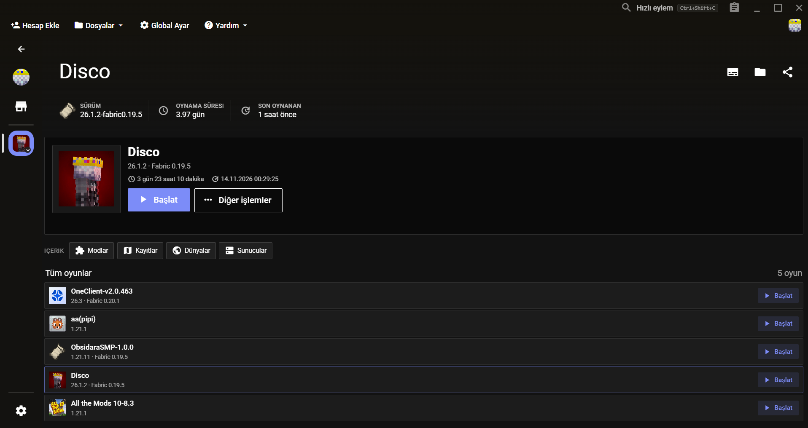
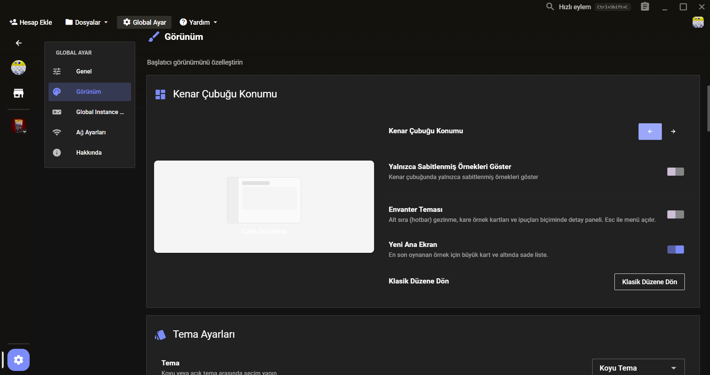
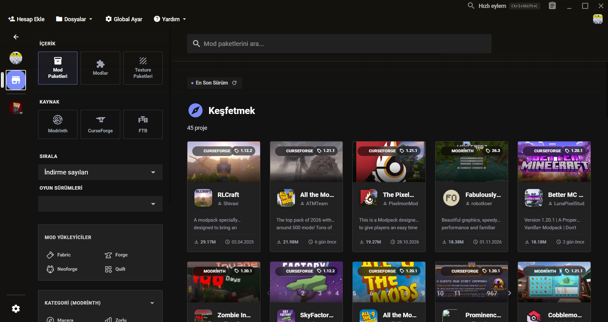
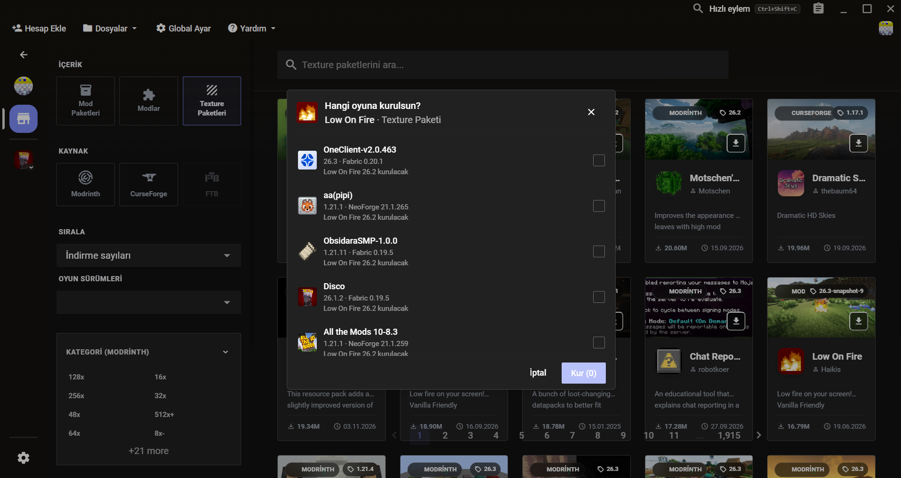

# Disco Launcher

Türkçe: [README.tr.md](README.tr.md)

A Minecraft launcher built on [X Minecraft Launcher (XMCL)](https://github.com/Voxelum/x-minecraft-launcher),
with an inventory-style home screen and a new dashboard.

## Screenshots






## Features

### Accounts
- Microsoft account sign-in and offline account sign-in.
- Local skin upload.
- A custom cape that only Disco users can see.

### Games
- Instance management: create, copy, delete and launch instances.
- Mod loader support: Fabric, Forge, NeoForge and Quilt.
- Playtime stats: recent play, total playtime, last played.
- MC Settings editor: edit options.txt, save and apply favorite setting sets.

### Store
- Modrinth, CurseForge and FTB stores.
- Browse and install mods, mod packs and texture packs.
- Choose the target instance during installation.

### Customization
- Inventory theme (the app shell becomes a hotbar).
- New home screen with a hero card and a content bar.
- Theme and surface colors, including the launch button.
- Discord Rich Presence.

### Removed
- Telemetry, auto-update, in-app news, friends list, P2P support and AI agent settings.

## Notes
- Offline accounts do not work on servers with online mode enabled.
- The custom cape is only visible to other Disco users. It does not affect your Mojang cape.
- Inventory theme and the new home screen can be turned off in Settings > Appearance.
- The CurseForge store requires your own API key (Settings > API Keys). Free keys are available at console.curseforge.com.

## Installation
Download an installer from the Releases page:
https://github.com/Discoheadmc/Disco-Launcher/releases

Supported platforms:
- Windows (NSIS installer, x64)
- macOS (dmg)
- Linux (deb, rpm, AppImage, tar.xz, pacman)

## Building from source
Prerequisites:
- Node.js >= 22.16
- pnpm 11 (this repo pins pnpm@11.10.0)

Install dependencies and start the dev app:
```
pnpm install
pnpm dev:main
```

Build the installer:
```
pnpm build
```

Run tests and checks:
```
pnpm test
pnpm check
```

## Legal
Disco Launcher is not affiliated with Mojang Studios or Microsoft. Minecraft is a trademark of Mojang Studios.

## License
Disco Launcher is released under the MIT License. See [LICENSE](LICENSE).

Copyright (c) 2023 ci010 (cijhn@hotmail.com)

XMCL is MIT licensed; the original copyright notice is preserved in the LICENSE file.

Disco Launcher is maintained by [Discoheadmc](https://github.com/Discoheadmc).

## Special Thanks
Disco Launcher is built on X Minecraft Launcher (XMCL) by [Voxelum](https://github.com/Voxelum/x-minecraft-launcher),
which provides the instance management and the download core used by this project. Sincere thanks to ci010
and all XMCL contributors for the launcher this project started from.

## Third-party components
- Vue 3 and Vuetify (MIT)
- Electron (MIT)
- skinview3d (MIT), which renders the 3D skin preview and bundles the Minecraft-style pixel font
- Material Symbols icons (Apache License 2.0)
- Modrinth, CurseForge and FTB APIs, used under their own terms