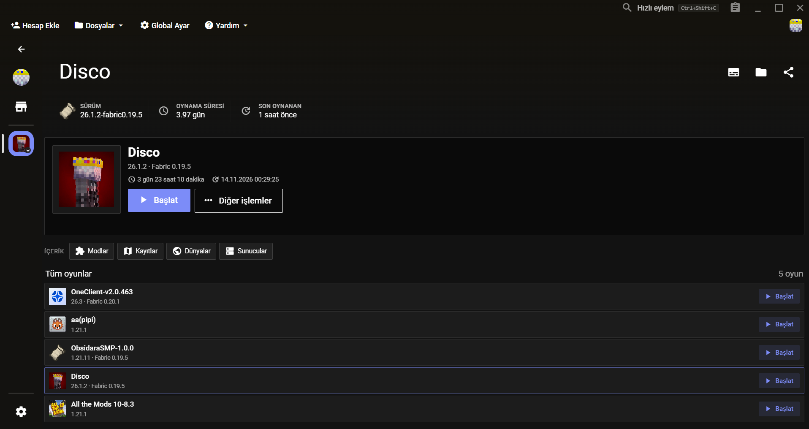
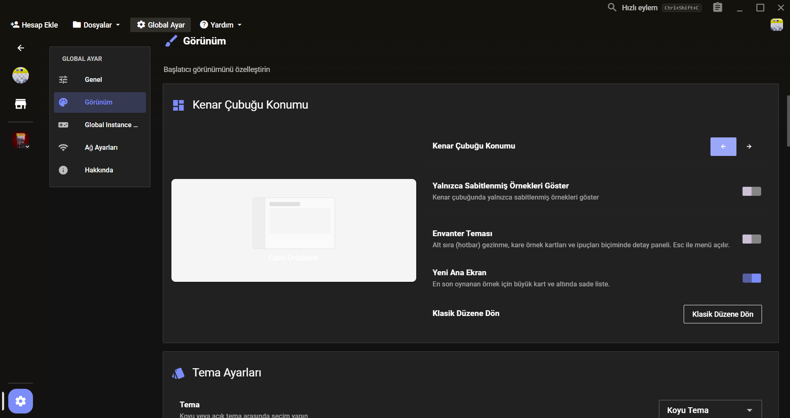
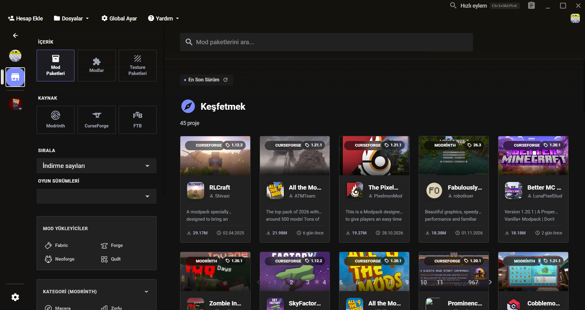
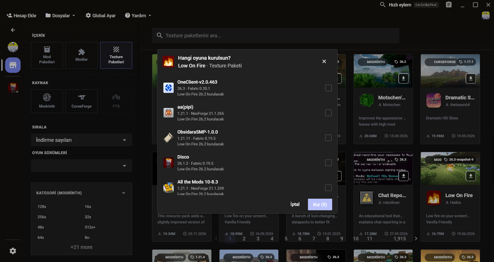

# Disco Launcher

English: [README.md](README.md)

X Minecraft Launcher (XMCL) üzerine kurulmuş, envanter tarzı ana ekran ve yeni kontrol paneli sunan bir Minecraft başlatıcısı.

## Ekran Görüntüleri






## Özellikler

### Hesaplar
- Microsoft hesabıyla ve çevrimdışı hesapla giriş.
- Yerel skin yükleme.
- Yalnızca Disco kullanıcılarının göreceği özel pelerin.

### Oyunlar
- Instance yönetimi: oluşturma, kopyalama, silme ve başlatma.
- Mod loader desteği: Fabric, Forge, NeoForge ve Quilt.
- Oynama istatistikleri: son oynanan, toplam süre, en son oynama.
- MC Ayarları düzenleyici: options.txt düzenleme, favori ayar setlerini kaydetme ve uygulama.

### Mağaza
- Modrinth, CurseForge ve FTB mağazaları.
- Mod, mod paketi ve texture paketi arama ve kurulum.
- Kurulum sırasında hedef instance seçimi.

### Özelleştirme
- Envanter Teması (uygulama kabuğu bir hotbar'a dönüşür).
- Yeni Ana Ekran (hero kart ve içerik şeridiyle).
- Tema ve yüzey renkleri (Başlat butonu dahil).
- Discord Rich Presence.

### Kaldırılanlar
- Telemetri, otomatik güncelleme, uygulama içi haber bölümü, arkadaş listesi, P2P desteği ve AI ajan ayarları.

## Notlar
- Çevrimdışı hesaplar online mode açık sunucularda çalışmaz.
- Özel pelerin yalnızca diğer Disco kullanıcılarına görünür. Mojang pelerinini etkilemez.
- Envanter Teması ve Yeni Ana Ekran, Ayarlar > Görünüm bölümünden kapatılabilir.
- CurseForge mağazası kendi API anahtarınızı ister (Ayarlar > API Anahtarları). Ücretsiz anahtar için: console.curseforge.com.

## Kurulum
İndiricileri Releases sayfasından indirin:
https://github.com/Discoheadmc/XMCL-Disco/releases

Desteklenen platformlar:
- Windows (NSIS yükleyici, x64)
- macOS (dmg)
- Linux (deb, rpm, AppImage, tar.xz, pacman)

## Kaynaktan Derleme
Ön koşullar:
- Node.js >= 22.16
- pnpm 11 (bu depo pnpm@11.10.0 kullanır)

Bağımlılıkları kur ve geliştirme sürümünü başlat:
```
pnpm install
pnpm dev:main
```

İndirici derleme:
```
pnpm build
```

Test ve kontroller:
```
pnpm test
pnpm check
```

## Yasal Not
Disco Launcher, Mojang Studios veya Microsoft ile bağlantılı değildir. Minecraft, Mojang Studios'un ticari markasıdır.

## Lisans
Disco Launcher MIT Lisansı ile yayınlanmaktadır. Bkz. [LICENSE](LICENSE).

Copyright (c) 2023 ci010 (cijhn@hotmail.com)

XMCL MIT lisanslıdır; orijinal telif hakkı bildirimi LICENSE dosyasında korunmaktadır.

Disco Launcher, [Discoheadmc](https://github.com/Discoheadmc) tarafından sürdürülmektedir.

## Özel Teşekkür
Disco Launcher, [Voxelum](https://github.com/Voxelum/x-minecraft-launcher) ekibinin X Minecraft Launcher (XMCL) projesi
üzerine kurulmuştur; bu projenin sağladığı instance yönetimi ve indirme çekirdeğini kullanır. Bu projenin
doğduğu launcher için ci010'a ve tüm XMCL katkıcılarına içten teşekkürler.

## Kullanılan Bileşenler
- Vue 3 ve Vuetify (MIT)
- Electron (MIT)
- skinview3d (MIT) — 3D skin önizlemesini ve Minecraft tarzı piksel yazı tipini sağlar
- Material Symbols ikonlar (Apache License 2.0)
- Modrinth, CurseForge ve FTB API'leri, kendi koşulları altında kullanılır